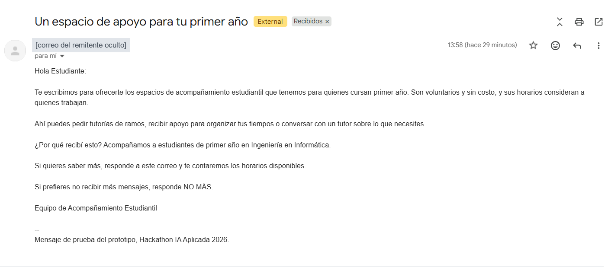

# Alerta temprana y acompañamiento · Primer año Duoc UC


**Hackathon de IA Aplicada · Congreso Social UC 2026** (PUC Chile · Duoc UC)
Desafío 2: **deserción en educación superior** · 🥈 **2.º lugar**

Prototipo que estima el riesgo de deserción de estudiantes de primer año —con foco en los **vespertinos que trabajan**— y organiza el acompañamiento según ese riesgo. Combina un modelo interpretable, una auditoría de sesgos y la API de Claude para redactar mensajes, siempre con una persona tomando las decisiones importantes.

> [!NOTE]
> Todos los datos son **sintéticos** y ningún mensaje se envía de verdad: los envíos quedan en una bandeja simulada. La única excepción fue una prueba de correo real, autorizada por el equipo y limitada a una lista blanca, documentada en [`docs/evidencia_correo_real.md`](docs/evidencia_correo_real.md).

---

## Tabla de contenidos

- [El problema](#el-problema)
- [La solución](#la-solución)
- [Flujo del sistema](#flujo-del-sistema)
- [IA responsable](#ia-responsable)
- [Panel](#panel)
- [Stack tecnológico](#stack-tecnológico)
- [Estructura del repositorio](#estructura-del-repositorio)
- [Instalación y uso](#instalación-y-uso)
- [Verificación](#verificación)
- [Equipo](#equipo)

---

## El problema

La deserción en primer año suele detectarse tarde, cuando el estudiante ya dejó de asistir. Los estudiantes vespertinos que trabajan son los más expuestos: tienen menos tiempo, su asistencia es irregular por motivos laborales y un sistema de alertas ingenuo los marca como "en riesgo" por razones que no tienen que ver con su compromiso académico.

## La solución

1. **Detectar a tiempo**: un modelo de regresión logística estima el % de riesgo a partir de la conducta académica semanal (asistencia y notas, como las que registra VIVO) y entrega las **3 razones** principales de cada estimación.
2. **Actuar según el nivel**:

   | Nivel | Riesgo | Acción |
   |---|---|---|
   | Bajo | < 40 % | Sin acción individual |
   | Medio | 40–70 % | Invitación automática a los espacios de apoyo, programada con 24 h para que el tutor la revise |
   | Alto | > 70 % | Un tutor revisa el caso y **decide** qué hacer |

3. **Acompañar**: Claude explica el riesgo al tutor, redacta invitaciones y recordatorios, clasifica los check-ins de los estudiantes, resume cada sección para el jefe de carrera y sugiere apoyos (tutorías, organización del tiempo o apoyo económico de la **Fundación Puente**, que requiere el consentimiento del estudiante).
4. **Planificar**: un planificador determinista propone bloques de estudio compatibles con el horario laboral del estudiante.

## Flujo del sistema

```
 ┌──────────────────────┐
 │ generar_datos.py     │  export simulado de VIVO (perfil + asistencia/notas semanales)
 └──────────┬───────────┘
            │  solo conducta académica
            ▼
 ┌──────────────────────┐      género, sede, jornada, trabajo, origen
 │ modelo.py            │ ───► auditoria.py (solo auditar sesgos, nunca entrada)
 │ % riesgo + 3 razones │
 └──────────┬───────────┘
            ▼
 ┌──────────────────────┐
 │ nivel (config.py)    │  bajo <40%  ·  medio 40–70%  ·  alto >70%
 └───┬──────────┬───────┘
     │ bajo     │ medio / alto
     ▼          ▼
  sin acción  ┌──────────────────────┐
  individual  │ seudonimizar.py      │  nada identificable sale del sistema
              └──────────┬───────────┘
                         ▼
              ┌──────────────────────┐
              │ claude_client.py     │  explica riesgo · redacta invitación ·
              │ (prompts/*.txt)      │  clasifica check-ins · resume sección
              └──────────┬───────────┘
                         ▼
              ┌──────────────────────┐
              │ app.py: panel tutor  │  alto: un tutor revisa y DECIDE
              └──────────┬───────────┘
                         ▼
              ┌──────────────────────┐
              │ programador.py       │  ventana de 24 h · 1 recordatorio a los 7 días
              └──────────┬───────────┘
                         ▼
              ┌──────────────────────┐
              │ bandeja simulada     │  data/bandeja_simulada.jsonl
              └──────────────────────┘
```

## IA responsable

El diseño parte del checklist ético de la hackathon:

- **Variables sensibles fuera del modelo**: género, sede, jornada, situación laboral y origen **nunca** son entradas; solo se usan para auditar.
- **Auditoría y mitigación de sesgos**: se comparan falsos positivos por grupo con predicciones fuera de muestra (5-fold estratificado). El dataset inyecta un sesgo realista (caídas de asistencia aisladas en vespertinos que trabajan) y el modelo de producción lo mitiga suavizando la asistencia con una mediana móvil de 3 semanas. Una brecha de falsos positivos mayor a 10 pp entre grupos se marca como disparidad.
- **Privacidad**: antes de llamar a Claude, `seudonimizar.py` reemplaza la identidad por un seudónimo (HMAC) y solo envía nivel, riesgo, razones y carrera. Los nombres se insertan localmente, al momento de enviar, y los textos libres pasan por un filtro de datos personales.
- **Humano en el circuito**: los casos de riesgo alto, los check-ins que piden derivación, los apoyos externos y los casos con datos de asistencia poco confiables **nunca** se envían solos.
- **Derecho a no recibir más**: responder "NO MÁS" cancela todo lo programado para ese estudiante.
- **Detección de crisis**: los check-ins con señales de crisis se derivan de inmediato a una persona.
- **Límites de uso**: tope de 200 llamadas a la API por ciclo, log de cada llamada y modo `OFFLINE` con caché para la demo.

## Panel

El panel de Streamlit tiene cuatro vistas:

| Vista | Para qué sirve |
|---|---|
| **Jefe de carrera** | Resumen por sección redactado por Claude y distribución de niveles de riesgo |
| **Tutor** | Bandeja de casos, explicación del riesgo, mensajes programados (enviar, editar, cancelar o contactar en persona), check-ins, plan de estudio y autorizaciones de apoyo |
| **Estudiante** | Lo que recibe el estudiante, con la explicación de "¿por qué recibí esto?" |
| **Auditoría** | Métricas por grupo antes y después de la mitigación |



## Stack tecnológico

| Área | Herramientas |
|---|---|
| Lenguaje | Python 3.11+ |
| Modelo | scikit-learn (regresión logística + `StandardScaler`), pandas |
| IA generativa | Anthropic Claude API (`claude-haiku-5-5` por defecto), prompts versionados en `prompts/` |
| Interfaz | Streamlit |
| Correo (solo demo) | `smtplib` con STARTTLS y lista blanca |
| Pruebas | pytest y scripts de verificación por ciclo |

## Estructura del repositorio

| Ruta | Rol |
|---|---|
| `src/config.py` | Umbrales, rutas, variables permitidas/prohibidas, `ANTHROPIC_MODEL`, `OFFLINE` |
| `src/generar_datos.py` | Dataset sintético tipo VIVO (600 estudiantes, sesgo inyectado y 12 casos demo) |
| `src/modelo.py` | Modelo interpretable, nivel de riesgo y 3 razones |
| `src/auditoria.py` | Métricas por grupo demográfico |
| `src/seudonimizar.py` | Seudónimos y filtro de datos personales antes de llamar a Claude |
| `src/claude_client.py` | Llamadas a Claude con caché offline, log y tope de llamadas |
| `src/generar_cache.py` | Ejecuta los usos de Claude sobre los 12 casos demo y guarda `data/cache_claude.json` |
| `src/programador.py` | Envíos programados con reloj simulado, recordatorios y excepciones |
| `src/correo.py` | Envío real de correo, solo para la demo y solo a la lista blanca |
| `src/apoyos.py` | Catálogo de apoyos y flujo propuesta → tutor → consentimiento |
| `src/plan_estudio.py` | Planificador determinista de bloques de estudio (sin Claude) |
| `src/demo_panel.py` | Estado inicial del panel y helpers compartidos |
| `prompts/` | Plantillas de los prompts |
| `app.py` | Panel Streamlit |
| `run_demo.py` | Pipeline completo con un solo comando |
| `verify/` | Verificación por ciclo de desarrollo (`cicloN.py`) y `run_all.py` |
| `docs/` | Guías de las etapas de la hackathon, checklist ético y evidencia del correo real |
| `data/` | Archivos generados (excluidos de git) |

## Instalación y uso

```bash
git clone https://github.com/abrahampuente/Hackathon-IA-Aplicada.git
cd Hackathon-IA-Aplicada

python -m venv .venv
source .venv/bin/activate        # Windows: .venv\Scripts\activate
pip install -r requirements.txt

cp .env.example .env             # Windows: copy .env.example .env
```

Variables principales de `.env`:

| Variable | Descripción |
|---|---|
| `ANTHROPIC_API_KEY` | API key de Anthropic (no necesaria con `OFFLINE=1`) |
| `ANTHROPIC_MODEL` | Modelo de Claude (por defecto `claude-haiku-5-5`) |
| `OFFLINE` | `1` = no llama a la API y usa la caché o plantillas |
| `MODO_CORREO_REAL` | `0` por defecto: ningún correo sale del sistema |
| `CORREOS_PERMITIDOS` | Lista blanca de destinatarios para la demo |

Ejecuta el pipeline y abre el panel:

```bash
python run_demo.py      # genera datos, entrena, audita y prepara los casos demo
streamlit run app.py    # abre el panel en http://localhost:8501
```

## Verificación

El desarrollo se organizó en ciclos con criterios de aceptación verificables:

| Ciclo | Qué verifica |
|---|---|
| 0 | Entorno: Python ≥ 3.11, dependencias, `.env` fuera de git y una llamada mínima a Claude (sin imprimir la key) |
| 1 | Arquitectura y estructura del repositorio |
| 2 | Dataset sintético: 600 filas, rangos válidos y sesgo inyectado |
| 3 | Modelo explicable (AUC ≥ 0,75) y auditoría de sesgos |
| 4 | Integración con Claude: salidas válidas para los 12 casos demo |
| 5 | Panel, envíos programados y decisión humana |
| correo | Envío real solo con lista blanca y SMTP simulado en las pruebas |

```bash
python verify/run_all.py
```

## Equipo

Proyecto del equipo del **grupo 2** en la Hackathon de IA Aplicada 2026.
Liderazgo técnico: **Abraham Puente** · [@abrahampuente](https://github.com/abrahampuente)

> Prototipo académico. Antes de usarlo con estudiantes reales haría falta validar el modelo con datos institucionales, revisar el tratamiento de datos con la institución y obtener los consentimientos correspondientes.
